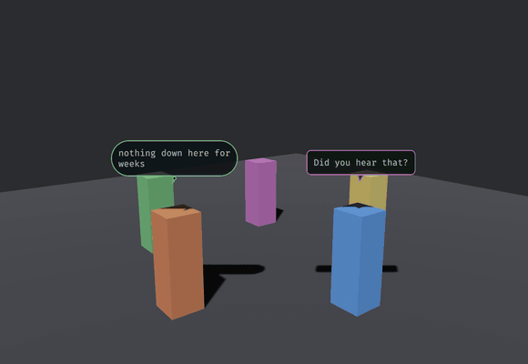

# bevy_speech_bubbles

A dialog kit for Bevy 0.20: world-space speech and thought balloons, a conversation graph with a runtime, paced barks, and a skinnable screen dialog box.



That is `examples/chatter.rs`. The balloons are **quads in the scene**, not a UI layer: they hold a world position above their owner, they can be occluded, and they turn because `track_bubbles` turns them. Two shapes carry the channel (a tailed balloon for what is said aloud, a soft pill with a dot-tail for what is only thought) and the border tint carries the affect.

This repository is canonical: MIT OR Apache-2.0, Bevy 0.20, and it co-evolves with the game it was built for, Sanctuary, as a path dependency.

## What is in it

- **Balloons** (`balloon`): `build_bubble`, `track_bubbles::<C>`, `expire_bubbles`, and a `BalloonSkin` for the palette. `BalloonSkin::crt()` is the phosphor look; `BalloonSkin::ink_on_paper()` is parchment with hard pixel edges (`pixel: true` draws without anti-aliasing and uses a nearest sampler).
- **A conversation kit** (`conversation`): a `DialogueScript` of named `Conversation`s, each a graph of `Node::Line` and `Node::Choice`, `validate_script`, and a runtime driven by the messages `StartConversation`, `ChoicePicked` and `ConversationEnded`. `DialogueNodeEntered` is written each time the cursor moves onto a node (the start, after each line, after each choice), so a host can attach effects to it. The model is `serde`: load it from YAML or RON. Speakers are strings the host resolves through `Speakers`. `Bark`s are paced one-off balloons.
- **A screen dialog box** (`dialog_box`): Bevy UI nodes skinned by `DialogSkin` (9-sliced frame, tiled paper, name tag, portrait, caret), with a typewriter, a pop on each line, and choices you can click, hover, arrow through, or pick with the number keys.
- **`SpeechBubblesPlugin::<C>`**: wires the three together, generic over the marker of the camera balloons face.

## Use

```rust
app.add_plugins(SpeechBubblesPlugin::<MyCamera>::default())
    .insert_resource(Presenter::DialogBox) // or Presenter::Balloons, the default
    .insert_resource(my_dialog_skin)       // a DialogSkin built from your theme
    .insert_resource(my_script);           // a DialogueScript, validated

// Balloons need a font (yours to load) and a quad:
commands.insert_resource(BubbleAssets {
    quad: meshes.add(Rectangle::new(1.0, 1.0)),
    font: FontArc::try_from_vec(std::fs::read("assets/fonts/Something.ttf")?)?,
});

speakers.0.insert("keeper".into(), Speaker { entity: Some(keeper), name: "The Keeper".into(), portrait: None });
starts.write(StartConversation { id: "gate".into() });
barks.write(Bark { speaker: "keeper".into(), kind: BubbleKind::Speech, emotion: Emotion::Neutral, text: "Mind the step.".into() });
```

While a conversation runs the resource `ConversationLock` exists: pause on it, and yield your own click handling to it. A script looks like this (RON; any serde format works):

```ron
(conversations: {
  "gate": (start: "greet", nodes: {
    "greet": Line(speaker: "keeper", text: "The gate has held three nights.", next: Some("ask")),
    "ask": Choice(speaker: "keeper", prompt: "Take the watch?", options: [
      (text: "I will.", next: "yes"),
      (text: "Ask someone else.", next: "no"),
    ]),
    "yes": Line(speaker: "keeper", text: "Good.", next: None),
    "no": Line(speaker: "keeper", emotion: Sadness, text: "Then I will ask the boy.", next: None),
  }),
})
```

`Presenter::Balloons` puts every line over its speaker's head and auto-advances after a reading-speed dwell; a speaker with no entity (a narrator) is skipped. `Presenter::DialogBox` shows the screen box and waits for the player: `Space`, `Enter` or a click completes a typing line and then advances it; `1`-`9`, the arrows with `Enter`, or the mouse pick an option. Barks are always world balloons.

## Scale and pixel balloons

Balloon size is the host's call. `BalloonScale { world_per_px, anchor_y }` (inserted with the default by the plugin; `track_bubbles` reads it every frame) sets world units per raster texel and the float height, so a world in feet and one in metres both fit, and changing it as the camera zooms resizes every live balloon. Spawn your own balloon quads with `BubblePx(rendered.px)` so `track_bubbles` can size them. `BalloonSkin::text_px` is the glyph size in raster px, and padding, tail, border and corner radius scale with it: `BalloonSkin::ink_on_paper()` has `text_px: 16` with `pixel: true`, which rasterizes at the native size of a 16 px pixel font (one texel per font pixel, a one-texel border, glyphs on whole texels, nearest sampler), roughly 150 to 200 texels wide for a 20-character line.

## Name your camera

`track_bubbles` and the plugin are generic over a camera **marker component**, deliberately. Bevy's `Single<..>` silently skips its system when the query does not match exactly one entity, so a tracking system filtered on `With<Camera3d>` works until something spawns a second 3D camera (a render-to-texture pass, a portal, a minimap), and then every balloon quietly stops tracking and nothing reports an error. Being generic makes it impossible for this crate to write that filter for you.

## The font is yours to load

`BubbleAssets` holds a quad mesh and a `FontArc`, and the dialog box takes `TextFont`s in its skin; this crate never reads a file. `BubbleAssets::from_font_bytes(quad, bytes)` builds the resource from raw font bytes, and `FontArc` is re-exported, so you need no `ab_glyph` dependency. A library that hardcoded `assets/fonts/…` would be hardcoding your project layout.

## Why the balloon text is rasterized here

Bevy's text stack has no public "rasterize this string into a standalone `Image`" API, and a world-space balloon has no 2D camera to host a `Text2d`. So glyphs go through `ab_glyph` into an RGBA buffer, once per line, and the buffer becomes a texture. The screen dialog box needs none of that and uses ordinary `Text`.

## Cosmetic by construction

Everything runs on `Time<Real>`, so balloons still expire and the typewriter still types while the host has paused virtual time. The conversation runtime runs in `PreUpdate` after Bevy's input systems, in the public `DialogInputSet`, and consumes the key and click presses it uses (`clear_just_pressed`): order your own `PreUpdate` systems `.after(DialogInputSet)` and a Space that ended a line is no longer `just_pressed` for them. The cosmetic systems (typewriter, caret, balloon tracking and expiry) stay in `Update`. The typewriter reads `DialogSkin::chars_per_second` every tick, so a settings menu can change the speed of the line on screen.

## Examples

```sh
cargo run --example two_balloons -- /System/Library/Fonts/Supplemental/Arial.ttf
cargo run --example chatter      -- /System/Library/Fonts/Supplemental/Arial.ttf
cargo run --example dialog_box   -- /System/Library/Fonts/Supplemental/Arial.ttf
```

`two_balloons` is the smallest thing that works. `chatter` is the gif above. `dialog_box` runs a four-node script with a choice in the screen box, skinned with flat colours generated in code (`F` cycles the typewriter speed). All need a GPU and take the font path as a required argument.

## License

MIT OR Apache-2.0, at your option.
